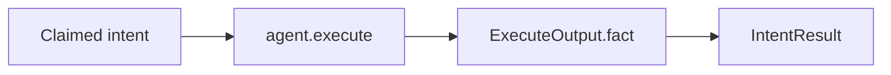
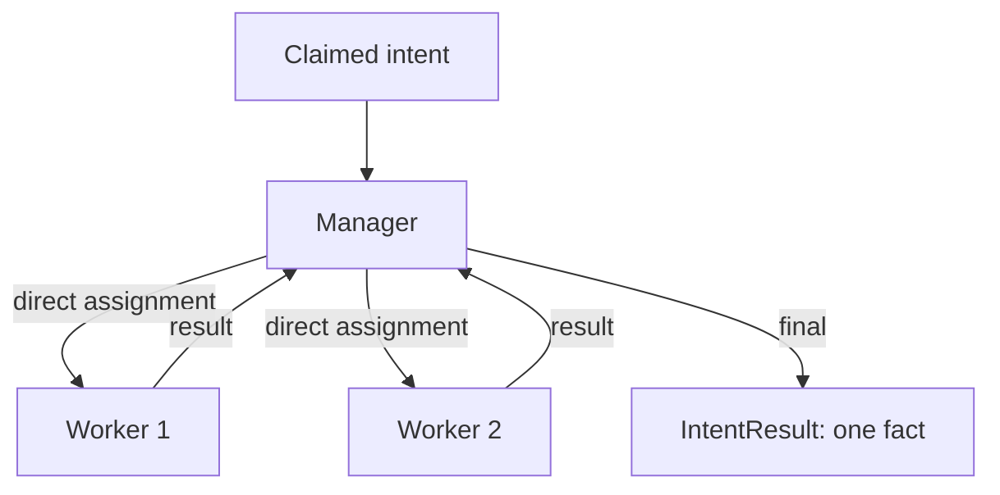
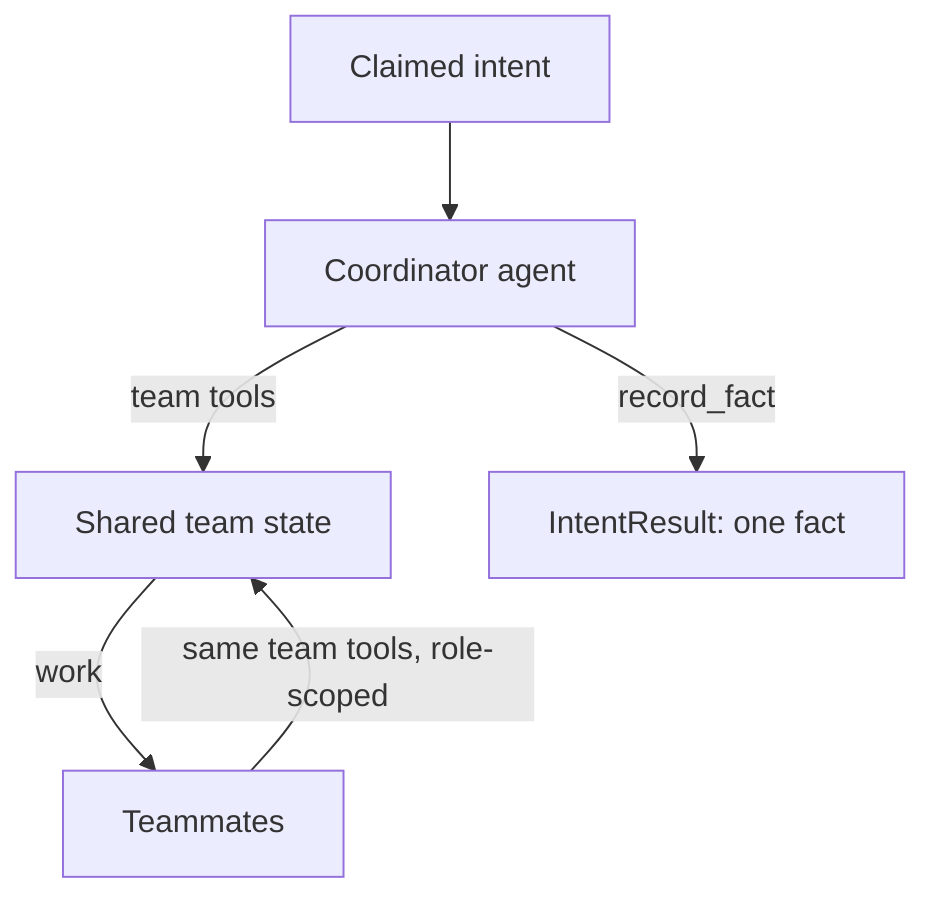

# DHI<sup>+</sup>

**Dynamic Heuristic Intelligence<sup>+</sup>**

DHI<sup>+</sup> is the team-execution upgrade to DHI. A goal still becomes a task and a plan, but the planner can choose a team, not only one worker. The team runs through a planner-selected topology, aggregates its work into one deterministic fact, and proves the goal with that fact. LLMs reason, tools act, PostgreSQL remembers, and the guard checks every action.

## DHI vs DHI<sup>+</sup>

| | DHI | DHI<sup>+</sup> |
| --- | --- | --- |
| Execution | One planner, one worker. | Single, manager-worker, or swarm. You can pin a topology at task creation; otherwise the planner chooses one per intent. |
| Fact | One planner, one worker, one fact. | One deterministic fact per intent, from any topology. |
| Capacity | Engine round and no-progress budgets. | Visible, extendable capacity ledger; exhaustion pauses and extension resumes. |
| UI | Individual work view. | Team UI for swarm state, team messages, capacity, and approvals. |

DHI<sup>+</sup> is the default line. Legacy DHI is preserved as branch `DHI` and tag `DHI-v1.0.1`.

### Historical DHI baseline

Legacy DHI is the historical single-worker baseline. It is unchanged. The shared foundations below still apply to DHI<sup>+</sup>.

### Shared DHI foundations

The unit of work is a task with a goal. The planner can add one intent, prove one open goal with a confirmed fact, or give up on a goal. Each intent runs through the selected topology and records one fact through tools. Every tool call is recorded, evaluated against guard rules, and then allowed, denied, or held for human approval. PostgreSQL is the system of record for tasks, goals, intents, facts, results, approvals, tool calls, agent runs, and activity.

## Core loop

Every topology uses the same engine contract:

```text
planner -> add_intent -> engine claim -> [INTENT EXECUTION]
        -> IntentResult(one fact) -> engine records fact -> planner
```

1. The planner calls `add_intent` with one intent and an optional plan.
2. The engine claims the intent.
3. The selected topology executes the intent.
4. Execution returns one `IntentResult` with one fact.
5. The engine records the fact.
6. The planner reviews the fact. It proves a goal or adds the next intent.

The engine is the only writer of task state. A team never proves a goal.

## Topologies

DHI<sup>+</sup> has three topologies: `single`, `manager_worker`, and `swarm`. They are separate. The task form can pin one, or let the planner choose.

### Single



- One worker.
- No team.
- No shared state.
- The worker executes the intent and returns one fact.

### Manager-worker



- A manager with a fixed team of workers.
- The manager does not do the work.
- The manager reads the results and says what each worker does next.
- Workers do not talk to each other.
- Workers do not share a board.
- Workers never coordinate.
- Workers do not claim tasks.
- Workers do not message peers.
- Workers execute the assigned task.
- The manager returns one final fact.
- Manager-worker is a direct-assignment hierarchy.
- Swarm is a shared-state team.
- They are separate topologies.
- They do not share the same coordinator implementation.

### Swarm



- Shared team state: task board, mailbox, mission log, outcomes, runs.
- The coordinator decides how to split work.
- The coordinator decides which agents to create.
- The coordinator decides how to combine results.
- The coordinator calls `record_fact` once for the intent.
- Teammates get the same team tools except `team_spawn_teammate`, `team_shutdown_teammate`, `team_cleanup`, and `team_finalize_outcome`.
- Only the coordinator can spawn, shut down, clean up, or finalize an outcome.

## Project folder and AGENTS.md

The user selects one absolute project folder on the DHI<sup>+</sup> host. The server-side file browser lists host folders through `GET /api/fs`. DHI<sup>+</sup> uses the selected folder directly. There is no upload copy.

The user selects one `AGENTS.md` file when the task needs it. The planner reads that file. DHI<sup>+</sup> does not change the selected `AGENTS.md`. The file must be named exactly `AGENTS.md`, live under `DHI_FILE_BROWSER_ROOT`, and be at most 32 KiB. It may be inside or outside the selected project folder.

The task folder is `<project>/.dhi/<task-id>`. The task container mounts `<project>` at `/project` read-only and the task folder at `/work` read-write. Existing project files do not change. DHI<sup>+</sup> writes only in `/work`.

`DHI_FILE_BROWSER_ROOT` sets the host root. The server and the Docker daemon must see the same absolute path. Mount the root into `dhi-server` at the same path, read-write:

```bash
docker compose -f docker-compose.yml -f docker-compose.fs.yml up -d
```

```yaml
services:
  dhi-server:
    volumes:
      - ${DHI_FILE_BROWSER_ROOT}:${DHI_FILE_BROWSER_ROOT}
```

`DHI_PROJECT_FOLDERS` is legacy only. It keeps tasks created before the file browser working. New tasks use the file browser.

## Task container and isolation

DHI<sup>+</sup> starts one task container per task through the host Docker socket. The DHI<sup>+</sup> container mounts the socket and includes the Docker CLI. A task container does not get the socket. The DHI<sup>+</sup> container can control Docker on the host. Use isolation on a host with other important services.

The task container has a read-only root filesystem. The selected project is mounted at `/project` read-only. The task folder is mounted at `/work` read-write. DHI<sup>+</sup> writes only under `/work`, which maps to `<project>/.dhi/<task-id>` on the host. Existing project files do not change. The container also has dropped capabilities, `no-new-privileges`, and memory, CPU, and PID caps.

Tasks created before the file browser can still use the workspace root.

## Features

### Current changes

- **Worker count** — 2–64, plus Auto. N counts teammates; the coordinator is one extra agent. All N run in parallel. A fixed N needs no approval. Auto uses up to 8 workers without approval. Auto above 8 needs a `swarm_scale` approval, up to 64.
- **Swarm workspace** — Task board (default), Mailbox (Inbox/Sent), Mission log, Outcomes, Runs, and Graph.
- **Team messages** — `GET /api/tasks/{id}/team/messages` returns direct and broadcast messages. The Graph tab shows the message routes.
- **Manager-worker lead loop** — the manager reads worker results and assigns each next task. It returns one final fact.
- **File browser** — the user selects a host project folder and an optional `AGENTS.md` through `GET /api/fs`. DHI<sup>+</sup> uses the folder in place.

### Core features

- **Task lifecycle** — create a task from a goal with optional capacity and profile pins, follow its planner/worker loop, stop or delete it, and restart recovery for unfinished work. Adding a goal to a finished task reopens it.
- **Three topologies** — single, manager-worker, and swarm. A task can pin one, or let the planner choose per intent.
- **Capacity ledger** — each task has visible `max_rounds`, `max_model_calls`, `max_wall_secs`, and `max_parallel_workers`. You can extend capacity from the Work view or the API. Exhaustion pauses the task; an extension resumes it. The host also keeps internal safety ceilings for rounds and no-progress rounds.
- **Graph and work views** — each task has a work graph, a work view, its activity log, and a live activity stream.
- **Approvals** — a guard rule may return `ask`. The call waits for a human decision or expires on its approval deadline.
- **MCP tools** — standard `mcpServers` configuration, guarded tool names of the form `mcp__<server>__<tool>`, live server management, refresh, reload, and deferred schemas above a tool threshold.
- **Web tools** — `web_search`, `web_read`, and `web_research` behind one provider router with fallback across TinyFish, Parallel, and Firecrawl. `web_read` also handles PDF and DOCX documents.
- **Coding tools** — `read`, `write`, `edit`, `search`, `list`, and `shell` run in a task container created through the host Docker socket. The project is at `/project` read-only; writes go to `/work`.
- **Persistent terminals** — `shell_open`, `shell_send`, `shell_read`, `shell_close`, and `shell_list` keep a long-lived shell in the task container.
- **Skills** — `skills/<name>/SKILL.md` instruction packs loaded through the guarded `load_skill` tool, with role visibility.
- **Custom tools** — file-defined tools backed by HTTP calls or direct commands, registered behind the same guard.
- **Profiles and pool** — OpenAI-compatible and Anthropic-format LLM profiles, active planner and worker profiles, an ordered failover pool with per-profile breakers, and optional per-task profile pins.
- **Specialists** — named sub-agents with scoped tool lists and turn budgets, used for delegation.
- **Tool control** — one catalog for every tool source, with enablement and role visibility.
- **Embedded UI** — the static Next.js export is served by the Rust process on the same origin as the API.

## Architecture

One Rust process, `dhi-server`, serves the JSON API under `/api` and the exported web UI. PostgreSQL is the only durable state store. Docker is used for the task containers that host coding tools and persistent terminals.

Workspace crates:

- `dhi-core` — domain types, task and intent state machines, team state, graph store traits
- `dhi-store` — PostgreSQL schema, store implementation, team state, scale approvals, management tables
- `dhi-engine` — planner/worker task loop, intent claim, and proof-based completion
- `dhi-orchestrator` — manager-worker lead loop, swarm coordinator and team runners, plan validation, deterministic aggregation
- `dhi-guard` — allow, deny, and ask policy plus the guarded tool executor
- `dhi-agent` — Rig runtime, prompts, LLM profiles, failover pool, coordinator and teammate runs, specialists
- `dhi-exec` — coding tools, task containers, project read-only and task write mounts
- `dhi-pty` — persistent terminal sessions inside task containers
- `dhi-followups` — side-question snapshots and task reopening rules
- `dhi-server` — Axum API, static UI hosting, file browser, team routes, scale approvals, wiring, and the binary
- `dhi-testkit` — in-memory store and test fixtures
- `dhi-mcp` — MCP configuration model and `dhi mcp` CLI
- `dhi-mcp-runtime` — guarded MCP connections, discovery, registration, dispatch
- `dhi-tool-source` — registration seam for tool sources
- `dhi-tool-catalog` — read model across every tool source
- `dhi-tool-control` — enablement, role visibility, usage
- `dhi-skills` — skill catalog and the `load_skill` tool
- `dhi-custom-tools` — file-defined guarded HTTP and command tools
- `dhi-web` — provider-neutral web search, read, and research tools
- `dhi-mcp-upgrade` — MCP visibility, deferred schemas, transport, and reload planning

The web app lives in `web/` (Next.js, React, Tailwind). Operational files live in `ops/` (prompts, specialists, MCP examples, custom-tool examples). Database roles and grants live in `docker/initdb/` and `docker/grants/`.

Every model tool call passes through one `GuardedExecutor`: record, evaluate the current policy snapshot, allow/deny/ask, then audit. The backend chain is persistent terminals → coding tools → web tools → skills → custom tools → MCP → the closed sources delegate. Unknown tool names fail closed.

## Requirements

- Rust 1.99.1 (pinned in `rust-toolchain.toml`)
- Node.js 22
- Docker with Compose v2
- PostgreSQL 16 (the compose file uses `postgres:16-alpine`)
- Optional: `uv`/`uvx` on the host for the chess MCP server

## Quick start with Docker

```bash
export DHI_IMAGE=ghcr.io/akshay93akshay/dhi:sha-<short>
docker compose pull dhi-server
docker compose up -d --no-build
```

- UI and API: http://127.0.0.1:8080
- Chess board: http://127.0.0.1:8090
- Health: `curl -fsS http://127.0.0.1:8080/api/health`

Copy `.env.example` to `.env` if you need LLM or web provider keys, and authenticate to GHCR first if you have not already (see [Container image](#container-image)). The published image contains the static UI; Compose starts PostgreSQL and `dhi-server`. `scripts/dhi-health.sh` checks the API, UI, PostgreSQL, disk space, and the optional chess board.

To use the project file browser, set `DHI_FILE_BROWSER_ROOT` and add `docker-compose.fs.yml` as shown in [Project folder and AGENTS.md](#project-folder-and-agentsmd).

`docker compose up --build` is only for local image development, not the deployment path.

## Container image

GitHub Actions builds and pushes the container image on `master` and `v*` tags. Feature branches and pull requests run code, web, and hygiene checks only.

- Registry: `ghcr.io/akshay93akshay/dhi`
- Tags: `sha-<short>` on every master build and the tag name on each `v*` release, such as `v1.0.0`. There is no `latest` tag.
- The package is private. Authenticate with a GitHub token that has only `read:packages`.

Pull on a server:

```bash
echo "$GHCR_TOKEN" | docker login ghcr.io -u akshay93akshay --password-stdin
export DHI_IMAGE=ghcr.io/akshay93akshay/dhi:sha-abc1234
docker compose pull dhi-server
docker compose up -d --no-build
```

To roll back, set `DHI_IMAGE` to the previous `sha-...` tag, then pull and start again. The image contains the Rust server, the static UI, `ops/`, the Docker CLI, and the pinned chess MCP runtime; it has no Rust or Node compiler.

For a final build, run the `fresh-image` workflow manually. It pulls fresh base images, uses the shared build cache, publishes `fresh-<short-sha>`, and verifies the pulled image. Use this for final deployment checks.

## Local development

```bash
docker compose up -d postgres
scripts/migrate.sh
scripts/dev.sh
```

`scripts/dev.sh` runs the API on http://127.0.0.1:8080 and the Next.js development server on http://127.0.0.1:3000. The development server proxies `/api` to port 8080.

To run the embedded static build instead:

```bash
cd web && npm ci && NEXT_EXPORT=1 npm run build
cd ..
cargo build -p dhi-server
scripts/dhi-service.sh install && scripts/dhi-service.sh start
```

The exported files are written to `web/out`, which the server serves on http://127.0.0.1:8080. Set `DHI_WEB_DIR` to serve an export from another directory. PostgreSQL must be running and migrated before the service starts.

### Build cache

Keep the Rust build cache between runs:

- Do not delete `target/`.
- Trim selectively with `cargo sweep --time 30` or `cargo clean -p <crate>`.
- Use `cargo check -p <crate>` for daily work.
- Run full `cargo test --workspace` and full clippy only before push.
- CI caches Rust dependencies now. The first run after the change is cold; the second run shows the benefit.

## Configuration

`.env.example` lists the runtime settings. Copy it to `.env` (ignored by Git) and fill in only the values you need. Docker Compose reads `.env` automatically.

Database roles:

- `dhi_owner` — migrations and schema owner
- `dhi_app` — runtime role
- `dhi_test` — test databases

Main settings:

- `DATABASE_URL` — runtime database connection
- `MIGRATION_DATABASE_URL` — migration connection
- `DHI_BIND` — API bind address, default `127.0.0.1:8080`
- `DHI_WEB_DIR` — static UI directory; when unset, `web/out` is used if present
- `DHI_WORKSPACE_ROOT` — workspace root visible to the server; defaults to `workspace`
- `DHI_WORKSPACE_HOST_ROOT` — host path of that root, used as the bind-mount source for task containers; set it when the server runs in a container
- `DHI_FILE_BROWSER_ROOT` — absolute host root listed by the project file browser; the server creates it when missing and refuses a symlink, and the server and Docker daemon must see the same path; unset disables the browser
- `DHI_PROJECT_FOLDERS` — legacy only: comma-separated absolute paths kept for tasks created before the file browser; each must remain mounted into the server at the same absolute path
- `DHI_MCP_CONFIG` — MCP config path; when unset, the nearest `ops/mcp.json`
- `DHI_LLM_BASE_URL`, `DHI_LLM_API_KEY`, `DHI_LLM_PLANNER_MODEL`, `DHI_LLM_WORKER_MODEL` — LLM endpoint and models; other OpenAI-compatible endpoints work
- `TINYFISH_API_KEY`, `PARALLEL_API_KEY`, `FIRECRAWL_API_KEY`, `DHI_WEB_PROVIDER` — web tool providers

On first boot, DHI<sup>+</sup> seeds guard rules plus LLM profiles and settings when an LLM key is configured. After that, PostgreSQL is the source of truth and profiles and rules are managed from the settings UI or API.

Never put secrets in Git. Keep local secret files at mode 600: `.env`, `ops/mcp.json`, `config/dhi.config.json`, and `web.env`.

## MCP and chess

`ops/mcp.example.json` is the portable example. On a host, copy it to `ops/mcp.json` (ignored by Git) and edit that file. The Docker image has its own `ops/mcp.docker.json`, copied to `/app/ops/mcp.json` at build time.

The example starts the chess MCP server through `uvx` and patches its dashboard to listen on `0.0.0.0:8090`, so the board is reachable from the host and through Docker port forwarding. Host chess requires `uv`/`uvx` on `PATH`. The chess board is served at http://127.0.0.1:8090.

Keep `ops/mcp.json` local. `ops/mcp.example.json` and `ops/mcp.docker.json` are safe to commit.

## Commands

| Command | Purpose |
| --- | --- |
| `scripts/check.sh` | Start PostgreSQL, then run rustfmt, clippy, workspace tests, web tests, and the static web build. `SKIP_DB=1` and `SKIP_WEB=1` skip those parts. |
| `scripts/test.sh` | Start PostgreSQL, run the workspace tests, and build the static web export. |
| `scripts/backup.sh [dir]` | Write a compressed logical backup of the database to `backups/` or the given directory. |
| `scripts/restore-test.sh [dump]` | Restore a backup into a throwaway database and compare row counts. |
| `scripts/dhi-health.sh [--api-only]` | Read-only check of API, UI, PostgreSQL, disk space, and the optional chess board. |
| `scripts/check-secrets.sh` | Read-only check of secret file modes and secret material in the repository. |
| `scripts/check-paths.sh` | Read-only check for machine-specific absolute paths in product files. |
| `scripts/check-stale.sh` | Read-only check for stale development-language markers in product files. |
| `scripts/target-gc.sh [--apply]` | Prune stale workspace build artifacts from `target/`; dry run by default. |
| `scripts/migrate.sh` | Apply migrations twice, apply runtime grants, and verify the activity lock. |
| `scripts/dev.sh` | Start PostgreSQL, migrate, then run the API on 8080 and Next dev on 3000. |
| `scripts/dhi-service.sh install\|start\|stop\|restart\|status` | Install and manage the background server; also manages web provider keys. |

## API overview

All API routes are under `/api`. Most return JSON; `/api/stream` is a server-sent event stream. The static UI is the fallback for non-API paths.

- **Health** — `GET /api/health`
- **Tasks** — `GET|POST /api/tasks`; `GET|DELETE /api/tasks/{id}`; `POST /api/tasks/{id}/stop`; `POST /api/tasks/{id}/capacity`; bulk `POST /api/tasks/stop` and `POST /api/tasks/delete`; `GET /api/tasks/{id}/work`, `/activity`, and `/usage`. `POST /api/tasks` accepts `goal`, `project_folder`, `agents_md_path`, `topology`, `swarm_workers`, capacity, and optional profile pins.
- **File browser** — `GET /api/fs` and `GET /api/fs?path=…` list host files and directories under `DHI_FILE_BROWSER_ROOT` for project and `AGENTS.md` selection
- **Team** — `GET /api/tasks/{id}/team`; `/team/tasks`; `/team/mailbox?box=inbox|sent`; `/team/messages`; `/team/mission`; `/team/runs`; `/team/outcomes`. Team state is read-only for the UI; agents change it through tools.
- **Goals** — `POST /api/tasks/{id}/goals`
- **Instructions** — `GET|POST /api/tasks/{id}/instructions`
- **Side questions** — `GET|POST /api/tasks/{id}/side-questions`
- **Approvals** — `GET /api/approvals`; `POST /api/approvals/{id}/decision`
- **Scale approvals** — `GET /api/scale-approvals`; `POST /api/scale-approvals/{id}/decision`. A `swarm_scale` row lets an Auto swarm rise above 8 workers.
- **Activity** — `GET /api/stream`
- **Settings and LLM profiles** — `GET|PUT /api/settings`; `GET|POST /api/llm/profiles`; `DELETE /api/llm/profiles/{id}`; `POST /api/llm/profiles/active`; `GET /api/llm/models`; `GET /api/llm/pool/status`; `POST /api/llm/pool/reset`
- **Guard rules** — `GET|POST /api/intercept/rules`; `PUT|DELETE /api/intercept/rules/{id}`; `POST /api/intercept/rules/{id}/toggle`
- **Tools** — `GET /api/tools/catalog`; `GET|POST /api/tools/control`
- **MCP** — `GET|POST /api/mcp/servers`; `PUT|PATCH|DELETE /api/mcp/servers/{name}`; `GET /api/mcp/servers/{name}/tools`; `POST /api/mcp/servers/{name}/refresh`; `POST /api/mcp/reload`
- **Web providers** — `GET /api/web/providers`; `PUT /api/web/providers/{provider}`; `DELETE /api/web/providers/{provider}/key`; `POST /api/web/providers/{provider}/test`; `POST /api/web/providers/reload`

## Security

DHI<sup>+</sup> has no login or authentication layer. Keep the default localhost bind, or put the server behind a protected tunnel or reverse proxy. Do not expose port 8080 directly to an untrusted network.

- The DHI<sup>+</sup> container mounts the host Docker socket. It can control Docker on the host. A task container does not get the socket, but the DHI<sup>+</sup> container is still a host-level control point. Use isolation on a shared host.
- Task containers have a read-only root filesystem. The selected project is read-only at `/project`. Only `/work` is writable, and it maps to `<project>/.dhi/<task-id>`.
- The file browser rejects paths outside `DHI_FILE_BROWSER_ROOT` and paths through a symlink. Task creation accepts an `AGENTS.md` only with the exact name.
- Keep `.env`, `ops/mcp.json`, `config/dhi.config.json`, and other key files out of Git and at mode 600.
- `ops/mcp.json` is ignored. The example and Docker configs contain no secrets.
- Use the database roles as designed: `dhi_owner` for migrations and `dhi_app` for runtime. The runtime role cannot modify or delete activity rows.
- The guard defaults to deny. Rules can allow, deny, or require approval, and every decision is recorded.
- The compose passwords are for local development. Use distinct strong credentials on any shared host.

## Troubleshooting

- **File browser is disabled** — `DHI_FILE_BROWSER_ROOT` is unset. Set it in `.env`, add `docker-compose.fs.yml`, and recreate `dhi-server`. `GET /api/fs` returns `404` while the browser is disabled.
- **Selected path is rejected** — the path is missing, is outside `DHI_FILE_BROWSER_ROOT`, passes through a symlink, or is not a directory. For `AGENTS.md`, use the exact name, keep it under the root, and keep it at or below 32 KiB.
- **Task container cannot mount the project** — the server and the Docker daemon do not see the same absolute path. Share the root with Docker Desktop, or create the same path on a remote daemon.
- **Missing `web/out`** — the server logs a warning and serves the API only. Build the export with `cd web && npm ci && NEXT_EXPORT=1 npm run build`, or point `DHI_WEB_DIR` at a directory that contains `index.html`.
- **Missing `uvx`** — host chess fails to start. Install `uv`, which provides `uvx`, or use the Docker image, which has the chess server installed at `/opt/chess`.
- **PostgreSQL is unhealthy** — check `docker compose ps`, then run `docker compose exec postgres pg_isready -U dhi_owner -d dhi`. Re-run `scripts/migrate.sh` if the schema is missing.
- **Port conflicts** — DHI<sup>+</sup> uses 8080 (API/UI), 8090 (chess), 5432 (PostgreSQL), and 3000 (Next dev). Set `DHI_BIND` or the compose port mappings, or stop the process using the port.
- **`DHI_WEB_DIR` does not take effect** — relative paths resolve from the server's working directory, and the directory must contain `index.html`. An empty value falls back to `web/out` when it exists.
