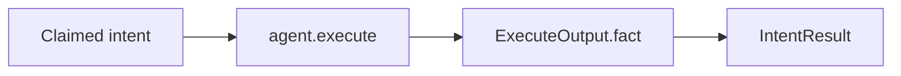
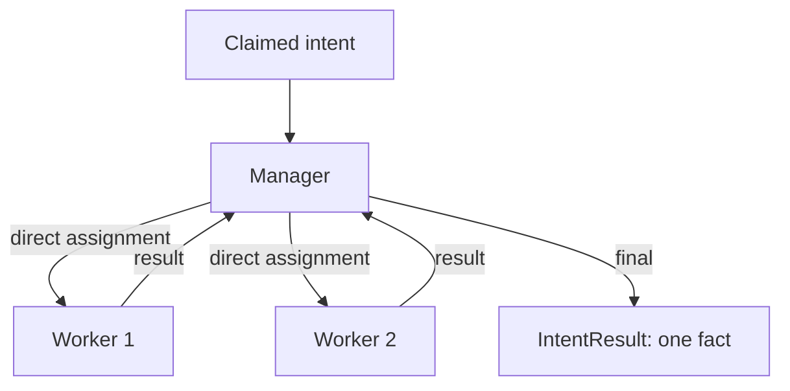
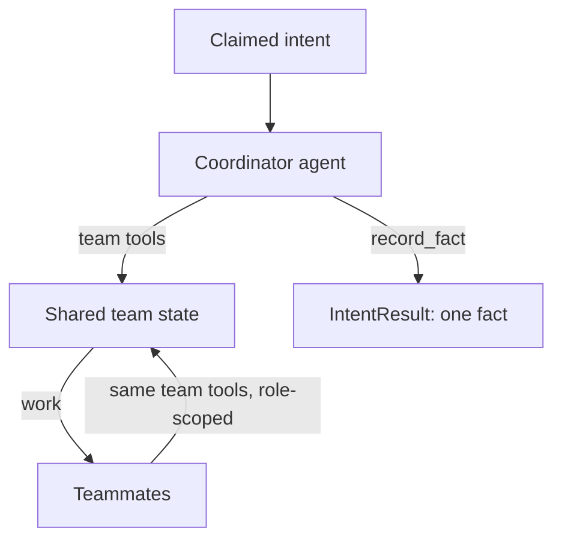

# DHI+ — Native macOS (No Docker)

**Dynamic Heuristic Intelligence<sup>+</sup>**

This branch runs DHI<sup>+</sup> natively on macOS. Task tools run as the same
macOS user as the server, under `/usr/bin/sandbox-exec` and a profile in this
repository.

- It does not use Docker Desktop, the Docker daemon, a Linux VM, or any other
  container runtime.
- It has no Dockerfile, no Compose file, and no Docker backend.
- The Docker version of DHI<sup>+</sup> remains on the `master` branch.

This branch is macOS only. It is tested on an Intel Mac.

DHI<sup>+</sup> is the team-execution upgrade to DHI. A goal still becomes a task and a plan, but the planner can choose a team, not only one worker. The team runs through a planner-selected topology, aggregates its work into one deterministic fact, and proves the goal with that fact. LLMs reason, tools act, PostgreSQL remembers, and the guard checks every action.

## DHI vs DHI<sup>+</sup>

| | DHI | DHI<sup>+</sup> |
| --- | --- | --- |
| Execution | One planner, one worker. | Single, manager-worker, or swarm. You can pin a topology at task creation; otherwise the planner chooses one per intent. |
| Fact | One planner, one worker, one fact. | One deterministic fact per intent, from any topology. |
| Capacity | Engine round and no-progress budgets. | Visible, extendable capacity ledger; exhaustion pauses and extension resumes. |
| UI | Individual work view. | Team UI for swarm state, team messages, capacity, and approvals. |

DHI<sup>+</sup> is the default line. Legacy DHI is preserved as branch `DHI` and tag `DHI-v1.0.1`.

### Historical DHI baseline

Legacy DHI is the historical single-worker baseline. It is unchanged. The shared foundations below still apply to DHI<sup>+</sup>.

### Shared DHI foundations

The unit of work is a task with a goal. The planner can add one intent, prove one open goal with a confirmed fact, or give up on a goal. Each intent runs through the selected topology and records one fact through tools. Every tool call is recorded, evaluated against guard rules, and then allowed, denied, or held for human approval. PostgreSQL is the system of record for tasks, goals, intents, facts, results, approvals, tool calls, agent runs, and activity.

## Core loop

Every topology uses the same engine contract:

```text
planner -> add_intent -> engine claim -> [INTENT EXECUTION]
        -> IntentResult(one fact) -> engine records fact -> planner
```

1. The planner calls `add_intent` with one intent and an optional plan.
2. The engine claims the intent.
3. The selected topology executes the intent.
4. Execution returns one `IntentResult` with one fact.
5. The engine records the fact.
6. The planner reviews the fact. It proves a goal or adds the next intent.

The engine is the only writer of task state. A team never proves a goal.

## Topologies

DHI<sup>+</sup> has three topologies: `single`, `manager_worker`, and `swarm`. They are separate. The task form can pin one, or let the planner choose.

### Single



- One worker.
- No team.
- No shared state.
- The worker executes the intent and returns one fact.

### Manager-worker



- A manager with a fixed team of workers.
- The manager does not do the work.
- The manager reads the results and says what each worker does next.
- Workers do not talk to each other.
- Workers do not share a board.
- Workers never coordinate.
- Workers do not claim tasks.
- Workers do not message peers.
- Workers execute the assigned task.
- The manager returns one final fact.
- Manager-worker is a direct-assignment hierarchy.
- Swarm is a shared-state team.
- They are separate topologies.
- They do not share the same coordinator implementation.

### Swarm



- Shared team state: task board, mailbox, mission log, outcomes, runs.
- The coordinator decides how to split work.
- The coordinator decides which agents to create.
- The coordinator decides how to combine results.
- The coordinator calls `record_fact` once for the intent.
- Teammates get the same team tools except `team_spawn_teammate`, `team_shutdown_teammate`, `team_cleanup`, and `team_finalize_outcome`.
- Only the coordinator can spawn, shut down, clean up, or finalize an outcome.

## Requirements

- macOS 14 or later, on Apple silicon or Intel. Tested on an Intel Mac.
- Xcode Command Line Tools, for `/usr/bin/sandbox-exec` and the system toolchain.
- Rust 1.99.1 (pinned in `rust-toolchain.toml`).
- Node.js 22, for the web UI.
- Native PostgreSQL 16 from prebuilt binaries (Postgres.app or EDB), on the same Mac and listening on `127.0.0.1:5432`.
- Optional: `uv`/`uvx` on the host for the chess MCP server.

## Quick start (native)

1. **Install PostgreSQL 16 from prebuilt binaries and create the database.** Use
   Postgres.app or the EDB PostgreSQL 16 binaries, set `PG_BIN` to its `bin`
   directory, and add it to `PATH`. Then run `initdb`, `pg_ctl`, and
   `createdb` as shown in
   [docs/macos-native.md](docs/macos-native.md#install-postgresql-16).
   On Intel macOS 14, Homebrew has no PostgreSQL 16 bottle and compiles from
   source; Homebrew is optional only on systems that have one.

2. **Apply roles and grants.** `scripts/migrate.sh` connects to the native
   PostgreSQL with `psql` as `dhi_owner`. It applies
   `ops/postgres/01-roles.sql` and `ops/postgres/02-grants.sql`, then verifies
   the activity lock. The server applies the application schema migrations at
   startup.

   ```bash
   scripts/migrate.sh
   ```

3. **Configure the environment.** Copy `.env.example` to `.env` (ignored by
   Git, mode 600) and fill in:

   - `DATABASE_URL`, `MIGRATION_DATABASE_URL`, `TEST_DATABASE_URL`
   - `DHI_SANDBOX_PROFILE` — absolute path to the profile in this checkout:
     `/Users/<you>/Desktop/dhi/ops/macos/dhi-task.sb`. Replace `<you>` with
     your macOS user name; `~` is not expanded. There is no install copy
   - `DHI_WORKSPACE_ROOT` — absolute path for legacy task work folders and
     per-task pidfiles
   - `DHI_FILE_BROWSER_ROOT` — absolute path for the project file browser
   - `DHI_LLM_BASE_URL`, `DHI_LLM_API_KEY`, `DHI_LLM_PLANNER_MODEL`,
     `DHI_LLM_WORKER_MODEL`

   The server reads `.env` from its working directory.

4. **Build and run.**

   ```bash
   cargo build -p dhi-server
   ./target/debug/dhi-server
   ```

   Or in one step:

   ```bash
   cargo run -p dhi-server
   ```

   The server applies the app migrations on startup, seeds guard rules and LLM
   profiles when an LLM key is set, and serves the exported UI from `web/out`
   when it exists.

5. **Verify the sandbox.**

   ```bash
   scripts/check-sandbox.sh
   scripts/check-sandbox.sh /path/to/project
   ```

   The script prints `PASS`, `FAIL`, or `SKIP` per test and exits nonzero on
   any `FAIL`. It needs no root.

6. **Open the UI and API** at http://127.0.0.1:8080. Health:
   `curl -fsS http://127.0.0.1:8080/api/health`.

## Isolation

Each task starts its own task sandbox. Details are in
[docs/macos-native.md](docs/macos-native.md).

- **Same macOS user.** Sandboxed commands run as the same macOS user as the
  server, under `/usr/bin/sandbox-exec` and the profile named by
  `DHI_SANDBOX_PROFILE`.
- **No privileged setup.** There is no `sudo`, no separate task user, no
  ACLs, no `/work` or `/project` aliases, and no reboot.
- **Real paths.** The profile receives the real absolute host paths for the
  project and the work folder.
- **Project read-only.** The project root is readable and never writable. A
  write into the project fails with `Operation not permitted`.
- **Writes confined.** Writes go only in `<project>/.dhi/<task-id>`, or the
  legacy `<DHI_WORKSPACE_ROOT>/<task-id>`, plus `/dev` and the server-owned
  per-task pidfile. The spill directory `<WORK>/.dhi` is write- and
  delete-denied.
- **No file content outside project and work.** File contents and directory
  listings outside the project and work folder are denied, including home
  directories and `~/.ssh`. `file-read-metadata` stays broad so tools can
  `stat` parent directories.
- **Network is allowed.** There is no network rule and no egress filtering.
- **Process cleanup.** Cleanup uses the per-task pidfile and the recorded
  process group. A leader whose command no longer contains
  `dhi-pids <pidfile>` is treated as a reused PID and is not killed.
  `DHI_TASK_ID` is diagnostic only. A child that deliberately calls `setsid`
  leaves the group and can survive.

The task runs with your user's privileges. This is a usability boundary
against accidents, not a security boundary against malicious code.

## Project folder and AGENTS.md

The user selects one absolute project folder in the DHI<sup>+</sup> UI. The file browser lists folders on the same Mac through `GET /api/fs`, under `DHI_FILE_BROWSER_ROOT`. DHI<sup>+</sup> uses the selected folder directly. There is no upload copy.

The user selects one `AGENTS.md` file when the task needs it. The planner reads that file. The selected rules also travel with the work as context, so the work can use a file outside the project folder. DHI<sup>+</sup> does not change the selected `AGENTS.md`. The file must be named exactly `AGENTS.md`, live under `DHI_FILE_BROWSER_ROOT`, and be at most 32 KiB. It may be inside or outside the selected project folder.

The task folder is `<project>/.dhi/<task-id>`. The task sandbox reads `<project>` and writes only in the task folder. Existing project files do not change.

The server and the task sandbox run on the same Mac and use the same real absolute paths. `DHI_FILE_BROWSER_ROOT` is a normal directory on this Mac, and the server creates it when missing. Unset disables the file browser. `/Users/Shared/dhi/projects` is the preferred root: it avoids TCC restrictions on `~/Desktop`, `~/Documents`, and `~/Downloads`. See [docs/project-file-browser.md](docs/project-file-browser.md).

`DHI_PROJECT_FOLDERS` is legacy only. It keeps tasks created before the file browser working. New tasks use the file browser.

## Features

### Current changes

- **Worker count** — 2–64, plus Auto. N counts teammates; the coordinator is one extra agent. All N run in parallel. A fixed N needs no approval. Auto uses up to 8 workers without approval. Auto above 8 needs a `swarm_scale` approval, up to 64.
- **Swarm workspace** — Task board (default), Mailbox (Inbox/Sent), Mission log, Outcomes, Runs, and Graph.
- **Team messages** — `GET /api/tasks/{id}/team/messages` returns direct and broadcast messages. The Graph tab shows the message routes.
- **Manager-worker lead loop** — the manager reads worker results and assigns each next task. It returns one final fact.
- **File browser** — the user selects a project folder and an optional `AGENTS.md` on the same Mac through `GET /api/fs`. DHI<sup>+</sup> uses the folder in place.

### Core features

- **Task lifecycle** — create a task from a goal with optional capacity and profile pins, follow its planner/worker loop, stop or delete it, and restart recovery for unfinished work. Adding a goal to a finished task reopens it.
- **Three topologies** — single, manager-worker, and swarm. A task can pin one, or let the planner choose per intent.
- **Capacity ledger** — each task has visible `max_rounds`, `max_model_calls`, `max_wall_secs`, and `max_parallel_workers`. You can extend capacity from the Work view or the API. Exhaustion pauses the task; an extension resumes it. The host also keeps internal safety ceilings for rounds and no-progress rounds.
- **Graph and work views** — each task has a work graph, a work view, its activity log, and a live activity stream.
- **Approvals** — a guard rule may return `ask`. The call waits for a human decision or expires on its approval deadline.
- **MCP tools** — standard `mcpServers` configuration, guarded tool names of the form `mcp__<server>__<tool>`, live server management, refresh, reload, and deferred schemas above a tool threshold.
- **Web tools** — `web_search`, `web_read`, and `web_research` behind one provider router with fallback across TinyFish, Parallel, and Firecrawl. `web_read` also handles PDF and DOCX documents.
- **Coding tools** — `read`, `write`, `edit`, `search`, `list`, and `shell` run in the task sandbox under `sandbox-exec`. The project is read-only; writes go to `<project>/.dhi/<task-id>`.
- **Persistent terminals** — `shell_open`, `shell_send`, `shell_read`, `shell_close`, and `shell_list` keep a long-lived shell in the same task sandbox.
- **Skills** — `skills/<name>/SKILL.md` instruction packs loaded through the guarded `load_skill` tool, with role visibility.
- **Custom tools** — file-defined tools backed by HTTP calls or direct commands, registered behind the same guard.
- **Profiles and pool** — OpenAI-compatible and Anthropic-format LLM profiles, active planner and worker profiles, an ordered failover pool with per-profile breakers, and optional per-task profile pins.
- **Specialists** — named sub-agents with scoped tool lists and turn budgets, used for delegation.
- **Tool control** — one catalog for every tool source, with enablement and role visibility.
- **Embedded UI** — the static Next.js export is served by the Rust process on the same origin as the API.
- **GPU** — raw Metal 3 and OpenCL 1.2 access inside the task sandbox. Build and run GPU code in the work folder.

## Architecture

One Rust process, `dhi-server`, serves the JSON API under `/api` and the exported web UI. PostgreSQL is the only durable state store. There is no container runtime and no VM. Coding tools and persistent terminals run in the native macOS task sandbox.

Workspace crates:

- `dhi-core` — domain types, task and intent state machines, team state, graph store traits
- `dhi-store` — PostgreSQL schema, store implementation, team state, scale approvals, management tables
- `dhi-engine` — planner/worker task loop, intent claim, and proof-based completion
- `dhi-orchestrator` — manager-worker lead loop, swarm coordinator and team runners, plan validation, deterministic aggregation
- `dhi-guard` — allow, deny, and ask policy plus the guarded tool executor
- `dhi-agent` — Rig runtime, prompts, LLM profiles, failover pool, coordinator and teammate runs, specialists
- `dhi-exec` — coding tools run in the native macOS task sandbox
- `dhi-pty` — persistent terminal sessions in the same task sandbox
- `dhi-followups` — side-question snapshots and task reopening rules
- `dhi-server` — Axum API, static UI hosting, file browser, team routes, scale approvals, wiring, and the binary
- `dhi-testkit` — in-memory store and test fixtures
- `dhi-mcp` — MCP configuration model and `dhi mcp` CLI
- `dhi-mcp-runtime` — guarded MCP connections, discovery, registration, dispatch
- `dhi-tool-source` — registration seam for tool sources
- `dhi-tool-catalog` — read model across every tool source
- `dhi-tool-control` — enablement, role visibility, usage
- `dhi-skills` — skill catalog and the `load_skill` tool
- `dhi-custom-tools` — file-defined guarded HTTP and command tools
- `dhi-web` — provider-neutral web search, read, and research tools
- `dhi-mcp-upgrade` — MCP visibility, deferred schemas, transport, and reload planning

The web app lives in `web/` (Next.js, React, Tailwind). Operational files live in `ops/` (prompts, specialists, MCP examples, custom-tool examples, and the macOS sandbox profile in `ops/macos/`). Native PostgreSQL roles and grants live in `ops/postgres/`. Schema migrations live in `crates/dhi-store/migrations/` and are applied by the server at startup.

Every model tool call passes through one `GuardedExecutor`: record, evaluate the current policy snapshot, allow/deny/ask, then audit. The backend chain is persistent terminals → coding tools → web tools → skills → custom tools → MCP → the closed sources delegate. Unknown tool names fail closed.

## Local development

```bash
scripts/migrate.sh
scripts/dev.sh
```

`scripts/dev.sh` runs the API on http://127.0.0.1:8080 and the Next.js development server on http://127.0.0.1:3000. The development server proxies `/api` to port 8080. PostgreSQL must be running natively and the roles and grants applied before either script starts.

To run the embedded static build instead:

```bash
cd web && npm ci && NEXT_EXPORT=1 npm run build
cd ..
cargo build -p dhi-server
scripts/dhi-service.sh install && scripts/dhi-service.sh start
```

The exported files are written to `web/out`, which the server serves on http://127.0.0.1:8080. Set `DHI_WEB_DIR` to serve an export from another directory. PostgreSQL must be running before the service starts; the server applies the app migrations itself.

### Build cache

Keep the Rust build cache between runs:

- Do not delete `target/`.
- Trim selectively with `cargo sweep --time 30` or `cargo clean -p <crate>`.
- Use `cargo check -p <crate>` for daily work.
- Run full `cargo test --workspace` and full clippy only before push.
- CI caches Rust dependencies now. The first run after the change is cold; the second run shows the benefit.

## Configuration

`.env.example` lists the runtime settings. Copy it to `.env` (ignored by Git) and fill in only the values you need. The server loads `.env` from its working directory at startup.

Database roles:

- `dhi_owner` — migrations and schema owner
- `dhi_app` — runtime role
- `dhi_test` — test databases

Main settings:

- `DATABASE_URL` — runtime database connection
- `MIGRATION_DATABASE_URL` — migration connection
- `TEST_DATABASE_URL` — test database connection
- `DHI_BIND` — API bind address, default `127.0.0.1:8080`
- `DHI_WEB_DIR` — static UI directory; when unset, `web/out` is used if present
- `DHI_SANDBOX_PROFILE` — absolute path to `ops/macos/dhi-task.sb` in this checkout, such as `/Users/<you>/Desktop/dhi/ops/macos/dhi-task.sb`; required, and `~` is not expanded. There is no install copy
- `DHI_WORKSPACE_ROOT` — absolute root for legacy task work folders and the per-task pidfiles in `pids/`
- `DHI_FILE_BROWSER_ROOT` — absolute root listed by the project file browser; the server creates it when missing and refuses a symlink; unset disables the browser
- `DHI_PROJECT_FOLDERS` — legacy only: comma-separated absolute paths kept for tasks created before the file browser
- `DHI_MCP_CONFIG` — MCP config path; when unset, the nearest `ops/mcp.json`
- `DHI_LLM_BASE_URL`, `DHI_LLM_API_KEY`, `DHI_LLM_PLANNER_MODEL`, `DHI_LLM_WORKER_MODEL` — LLM endpoint and models; other OpenAI-compatible endpoints work
- `TINYFISH_API_KEY`, `PARALLEL_API_KEY`, `FIRECRAWL_API_KEY`, `DHI_WEB_PROVIDER` — web tool providers

On first boot, DHI<sup>+</sup> seeds guard rules plus LLM profiles and settings when an LLM key is configured. After that, PostgreSQL is the source of truth and profiles and rules are managed from the settings UI or API.

Never put secrets in Git. Keep local secret files at mode 600: `.env`, `ops/mcp.json`, `config/dhi.config.json`, and `web.env`.

## MCP and chess

`ops/mcp.example.json` is the portable example. Copy it to `ops/mcp.json` (ignored by Git) and edit that file. The server uses the nearest `ops/mcp.json` unless `DHI_MCP_CONFIG` points elsewhere.

The example starts the chess MCP server through `uvx` and patches its dashboard to listen on `0.0.0.0:8090`. Chess requires `uv`/`uvx` on `PATH`. The chess board is served at http://127.0.0.1:8090.

Keep `ops/mcp.json` local. `ops/mcp.example.json` is safe to commit.

## Commands

| Command | Purpose |
| --- | --- |
| `scripts/check.sh` | Run rustfmt, clippy, workspace tests, web tests, and the static web build against a native PostgreSQL. `SKIP_DB=1` and `SKIP_WEB=1` skip those parts. |
| `scripts/test.sh` | Run the workspace tests against a native PostgreSQL and build the static web export. |
| `scripts/migrate.sh` | Apply `ops/postgres/01-roles.sql` and `ops/postgres/02-grants.sql` to the native database and verify the activity lock. The server applies app migrations at startup. |
| `scripts/check-sandbox.sh [project-dir]` | Acceptance checks for the native sandbox profile. No root needed. |
| `scripts/backup.sh [dir]` | Write a compressed logical backup of the database to `backups/` or the given directory. |
| `scripts/restore-test.sh [dump]` | Restore a backup into a throwaway database and compare row counts. |
| `scripts/dhi-health.sh [--api-only]` | Read-only check of API, UI, PostgreSQL, and disk space. |
| `scripts/check-secrets.sh` | Read-only check of secret file modes and secret material in the repository. |
| `scripts/check-paths.sh` | Read-only check for machine-specific absolute paths in product files. |
| `scripts/check-stale.sh` | Read-only check for stale development-language markers in product files. |
| `scripts/target-gc.sh [--apply]` | Prune stale workspace build artifacts from `target/`; dry run by default. |
| `scripts/dev.sh` | Migrate, then run the API on 8080 and Next dev on 3000. |
| `scripts/dhi-service.sh install\|start\|stop\|restart\|status` | Install and manage the background server; also manages web provider keys. |

## API overview

All API routes are under `/api`. Most return JSON; `/api/stream` is a server-sent event stream. The static UI is the fallback for non-API paths.

- **Health** — `GET /api/health`
- **Tasks** — `GET|POST /api/tasks`; `GET|DELETE /api/tasks/{id}`; `POST /api/tasks/{id}/stop`; `POST /api/tasks/{id}/capacity`; bulk `POST /api/tasks/stop` and `POST /api/tasks/delete`; `GET /api/tasks/{id}/work`, `/activity`, and `/usage`. `POST /api/tasks` accepts `goal`, `project_folder`, `agents_md_path`, `topology`, `swarm_workers`, capacity, and optional profile pins.
- **File browser** — `GET /api/fs` and `GET /api/fs?path=…` list folders on this Mac under `DHI_FILE_BROWSER_ROOT` for project and `AGENTS.md` selection
- **Team** — `GET /api/tasks/{id}/team`; `/team/tasks`; `/team/mailbox?box=inbox|sent`; `/team/messages`; `/team/mission`; `/team/runs`; `/team/outcomes`. Team state is read-only for the UI; agents change it through tools.
- **Goals** — `POST /api/tasks/{id}/goals`
- **Instructions** — `GET|POST /api/tasks/{id}/instructions`
- **Side questions** — `GET|POST /api/tasks/{id}/side-questions`
- **Approvals** — `GET /api/approvals`; `POST /api/approvals/{id}/decision`
- **Scale approvals** — `GET /api/scale-approvals`; `POST /api/scale-approvals/{id}/decision`. A `swarm_scale` row lets an Auto swarm rise above 8 workers.
- **Activity** — `GET /api/stream`
- **Settings and LLM profiles** — `GET|PUT /api/settings`; `GET|POST /api/llm/profiles`; `DELETE /api/llm/profiles/{id}`; `POST /api/llm/profiles/active`; `GET /api/llm/models`; `GET /api/llm/pool/status`; `POST /api/llm/pool/reset`
- **Guard rules** — `GET|POST /api/intercept/rules`; `PUT|DELETE /api/intercept/rules/{id}`; `POST /api/intercept/rules/{id}/toggle`
- **Tools** — `GET /api/tools/catalog`; `GET|POST /api/tools/control`
- **MCP** — `GET|POST /api/mcp/servers`; `PUT|PATCH|DELETE /api/mcp/servers/{name}`; `GET /api/mcp/servers/{name}/tools`; `POST /api/mcp/servers/{name}/refresh`; `POST /api/mcp/reload`
- **Web providers** — `GET /api/web/providers`; `PUT /api/web/providers/{provider}`; `DELETE /api/web/providers/{provider}/key`; `POST /api/web/providers/{provider}/test`; `POST /api/web/providers/reload`

## Security

DHI<sup>+</sup> has no login or authentication layer. Keep the default localhost bind, or put the server behind a protected tunnel or reverse proxy. Do not expose port 8080 directly to an untrusted network.

- The task sandbox runs as the same macOS user as the server under `sandbox-exec`. The project root is read-only. Only the task folder is writable, and it maps to `<project>/.dhi/<task-id>`. This is an accident boundary, not a boundary against malicious code; see [docs/macos-native.md](docs/macos-native.md#limits).
- The file browser rejects paths outside `DHI_FILE_BROWSER_ROOT` and paths through a symlink. Task creation accepts an `AGENTS.md` only with the exact name.
- Keep `.env`, `ops/mcp.json`, `config/dhi.config.json`, and other key files out of Git and at mode 600.
- `ops/mcp.json` is ignored. The example contains no secrets.
- Use the database roles as designed: `dhi_owner` for migrations and `dhi_app` for runtime. The runtime role cannot modify or delete activity rows.
- The guard defaults to deny. Rules can allow, deny, or require approval, and every decision is recorded.
- The example passwords in `.env.example` are for local development. Use distinct strong credentials on any shared Mac.

## Troubleshooting

- **Server fails to start with `DHI_SANDBOX_PROFILE`** — the value is unset, empty, relative, contains `~`, or names a missing or non-regular file. Use the full absolute path to `ops/macos/dhi-task.sb` in this checkout, for example `/Users/<you>/Desktop/dhi/ops/macos/dhi-task.sb`.
- **File browser is disabled** — `DHI_FILE_BROWSER_ROOT` is unset. Set it in `.env` and restart the server. `GET /api/fs` returns `404` while the browser is disabled.
- **Selected path is rejected** — the path is missing, is outside `DHI_FILE_BROWSER_ROOT`, passes through a symlink, or is not a directory. For `AGENTS.md`, use the exact name, keep it under the root, and keep it at or below 32 KiB.
- **Project folder or `AGENTS.md` lies under `~/Desktop`, `~/Documents`, or `~/Downloads` and is denied** — macOS TCC blocks the sandboxed task when the server itself lacks access. Move the root to `/Users/Shared/dhi/projects`, or grant the server access in System Settings → Privacy & Security.
- **A sandboxed write fails with `Operation not permitted`** — the command wrote outside `<project>/.dhi/<task-id>`, into the spill directory, or into the project. Move the write into the task folder.
- **A process survives task end** — it left its process group with `setsid`, so pidfile cleanup cannot find it. Stop it by PID.
- **Missing `web/out`** — the server logs a warning and serves the API only. Build the export with `cd web && npm ci && NEXT_EXPORT=1 npm run build`, or point `DHI_WEB_DIR` at a directory that contains `index.html`.
- **Missing `uvx`** — the chess MCP server fails to start. Install `uv`, which provides `uvx`.
- **PostgreSQL is not reachable** — confirm the native cluster is running and listening on `127.0.0.1:5432` (`"$PG_BIN/pg_isready" -h 127.0.0.1 -p 5432 -U dhi_owner -d dhi`). Start it with `"$PG_BIN/pg_ctl" -D <data-dir> -l <log> start`, or the optional LaunchAgent. Re-run `scripts/migrate.sh` if the roles or grants are missing; the server applies app migrations at startup.
- **Port conflicts** — DHI<sup>+</sup> uses 8080 (API/UI), 8090 (chess), 5432 (PostgreSQL), and 3000 (Next dev). Set `DHI_BIND` or stop the process using the port.
- **`DHI_WEB_DIR` does not take effect** — relative paths resolve from the server's working directory, and the directory must contain `index.html`. An empty value falls back to `web/out` when it exists.
