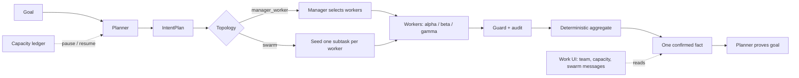

# DHI+

**Dynamic Heuristic Intelligence Plus**

DHI+ is the team-execution upgrade to DHI. A goal still becomes a task and a plan, but the planner can choose a team, not only one worker. The team runs through a planner-selected topology, aggregates its work into one deterministic fact, and proves the goal with that fact. LLMs reason, tools act, PostgreSQL remembers, and the guard checks every action.

## DHI vs DHI+

| | DHI | DHI+ |
| --- | --- | --- |
| Execution | One planner, one worker. | Planner-selected `manager_worker` or `swarm`. |
| Fact | One planner, one worker, one fact. | One deterministic aggregated fact per intent. |
| Capacity | Engine round and no-progress budgets. | Visible, extendable capacity ledger; exhaustion pauses and extension resumes. |
| UI | Individual work view. | Team UI for team runs, capacity, and swarm messages. |

## Core architecture



A DHI+ intent still follows the DHI lifecycle. The difference is the execution layer: the planner can expand one intent into a team, and the engine still records one fact.

## DHI+ orchestration

The planner selects the topology for each intent: `single`, `manager_worker`, or `swarm`. The team topologies, `manager_worker` and `swarm`, are planner-selected. `manager_worker` uses a manager to choose workers and subtasks within the planner's limits, then runs independent workers in parallel. `swarm` seeds one subtask per worker and lets peers exchange typed findings directly, stopping on its budget and stop rules.

Only each worker's seed turn enters the aggregated fact; reaction turns remain visible in the swarm audit and count against capacity. Either team topology still produces one confirmed fact for the intent. The guard and audit path is unchanged: every worker tool call passes through the same guarded executor, and the aggregate fact is recorded only after those decisions are applied.

Each task has a visible capacity ledger: `max_rounds`, `max_model_calls`, `max_wall_secs`, and `max_parallel_workers`. Omitted limits use the engine defaults. `POST /api/tasks` accepts the ledger at creation, `POST /api/tasks/{id}/capacity` extends it, and the Work view shows and edits it. Exhaustion pauses the task (never fails it); an extension resumes a paused task. Swarm broadcasts are durable and readable at `GET /api/tasks/{id}/swarm-messages`.

The engine budgets are:

```text
DHI_ENGINE_MAX_ROUNDS
DHI_ENGINE_NO_PROGRESS_ROUNDS
```

- DHI+ is the default line; legacy DHI is preserved as branch `DHI` and tag `DHI-v1.0.1`.
- CI builds the container image on GitHub Actions; no local Docker build is required.

## DHI baseline

DHI turns a goal into a task, a task into a plan, a plan into facts, and facts into results. The planner reads the work graph and proposes one intent at a time. A worker carries out that intent with guarded tools and records facts. A confirmed fact proves a goal, and the task is done only when every goal is met. LLMs reason, tools act, PostgreSQL remembers, and the guard checks every action.

## What DHI is

The unit of work is a task with a goal and a planning bound. The planner can add one intent, prove one open goal with a confirmed fact, or give up on a goal. Each intent is executed by a worker that records facts through tools. Every tool call is recorded, evaluated against guard rules, and then allowed, denied, or held for human approval. PostgreSQL is the system of record for tasks, goals, intents, facts, results, approvals, tool calls, agent runs, and activity.

## Features

- **Task lifecycle** — create a task from a goal and a bound, follow its planner/worker loop, stop or delete it, and restart recovery for unfinished work. Adding a goal to a finished task reopens it.
- **Graph and work views** — each task has a work graph and a work view, with its activity log and live activity stream.
- **Approvals** — a guard rule may return `ask`. The call waits for a human decision or expires on its approval deadline.
- **MCP tools** — standard `mcpServers` configuration, guarded tool names of the form `mcp__<server>__<tool>`, live server management, refresh, reload, and deferred schemas above a tool threshold.
- **Web tools** — `web_search`, `web_read`, and `web_research` behind one provider router with fallback across TinyFish, Parallel, and Firecrawl. `web_read` also handles PDF and DOCX documents.
- **Coding tools** — `read`, `write`, `edit`, `search`, `list`, and `shell` run in a task container created through the host Docker socket and rooted at the workspace.
- **Persistent terminals** — `shell_open`, `shell_send`, `shell_read`, `shell_close`, and `shell_list` keep a long-lived shell in the task container created through the host Docker socket.
- **Skills** — `skills/<name>/SKILL.md` instruction packs loaded through the guarded `load_skill` tool, with role visibility.
- **Custom tools** — file-defined tools backed by HTTP calls or direct commands, registered behind the same guard.
- **Profiles and pool** — OpenAI-compatible and Anthropic-format LLM profiles, active planner and worker profiles, an ordered failover pool with per-profile breakers, and optional per-task profile pins.
- **Specialists** — named sub-agents with scoped tool lists and turn limits, used for delegation.
- **Tool control** — one catalog for every tool source, with enablement and role visibility.
- **Embedded UI** — the static Next.js export is served by the Rust process on the same origin as the API.

## Architecture

One Rust process, `dhi-server`, serves the JSON API under `/api` and the exported web UI. PostgreSQL is the only durable state store. Docker is used for the task containers that host coding tools and persistent terminals.

Workspace crates:

- `dhi-core` — domain types, task and intent state machines, graph store traits
- `dhi-store` — PostgreSQL schema, store implementation, management tables
- `dhi-engine` — planner/worker task loop and proof-based completion
- `dhi-orchestrator` — manager-worker and swarm runners, plan validation, deterministic aggregation
- `dhi-guard` — allow, deny, and ask policy plus the guarded tool executor
- `dhi-agent` — Rig runtime, prompts, LLM profiles, failover pool, specialists
- `dhi-exec` — coding tools and per-task containers
- `dhi-pty` — persistent terminal sessions inside task containers
- `dhi-followups` — side-question snapshots and task reopening rules
- `dhi-server` — Axum API, static UI hosting, wiring, and the binary
- `dhi-testkit` — in-memory store and test fixtures
- `dhi-mcp` — MCP configuration model and `dhi mcp` CLI
- `dhi-mcp-runtime` — guarded MCP connections, discovery, registration, dispatch
- `dhi-tool-source` — registration seam for tool sources
- `dhi-tool-catalog` — read model across every tool source
- `dhi-tool-control` — enablement, role visibility, usage
- `dhi-skills` — skill catalog and the `load_skill` tool
- `dhi-custom-tools` — file-defined guarded HTTP and command tools
- `dhi-web` — provider-neutral web search, read, and research tools
- `dhi-mcp-upgrade` — MCP visibility, deferred schemas, transport, and reload planning

The web app lives in `web/` (Next.js, React, Tailwind). Operational files live in `ops/` (prompts, specialists, MCP examples, custom-tool examples). Database roles and grants live in `docker/initdb/` and `docker/grants/`.

Every model tool call passes through one `GuardedExecutor`: record, evaluate the current policy snapshot, allow/deny/ask, then audit. The backend chain is persistent terminals → coding tools → web tools → skills → custom tools → MCP → the closed sources delegate. Unknown tool names fail closed.

### Docker socket

The DHI container mounts the host Docker socket and includes the Docker CLI. It starts one task container per task through that socket. Task containers do not get the socket. The DHI container can control Docker on the host; do not use this on a host with other important services without isolation.

## Requirements

- Rust 1.99.1 (pinned in `rust-toolchain.toml`)
- Node.js 22
- Docker with Compose v2
- PostgreSQL 16 (the compose file uses `postgres:16-alpine`)
- Optional: `uv`/`uvx` on the host for the chess MCP server

## Quick start with Docker

```bash
export DHI_IMAGE=ghcr.io/akshay93akshay/dhi:sha-<short>
docker compose pull dhi-server
docker compose up -d --no-build
```

- UI and API: http://127.0.0.1:8080
- Chess board: http://127.0.0.1:8090
- Health: `curl -fsS http://127.0.0.1:8080/api/health`

Copy `.env.example` to `.env` if you need LLM or web provider keys, and authenticate to GHCR first if you have not already (see [Container image](#container-image)). The published image contains the static UI; Compose starts PostgreSQL and `dhi-server`. `scripts/dhi-health.sh` checks the API, UI, PostgreSQL, disk space, and the optional chess board.

`docker compose up --build` is only for local image development, not the deployment path.

## Container image

GitHub Actions builds the container image on every push and pull request. It pushes to GHCR only on `master` and `v*` tags; feature-branch and pull-request builds are validation-only.

- Registry: `ghcr.io/akshay93akshay/dhi`
- Tags: `sha-<short>` on every master build and the tag name on each `v*` release, such as `v1.0.0`. There is no `latest` tag.
- The package is private. Authenticate with a GitHub token that has only `read:packages`.

Pull on a server:

```bash
echo "$GHCR_TOKEN" | docker login ghcr.io -u akshay93akshay --password-stdin
export DHI_IMAGE=ghcr.io/akshay93akshay/dhi:sha-abc1234
docker compose pull dhi-server
docker compose up -d --no-build
```

To roll back, set `DHI_IMAGE` to the previous `sha-...` tag, then pull and start again. The image contains the Rust server, the static UI, `ops/`, the Docker CLI, and the pinned chess MCP runtime; it has no Rust or Node compiler.

## Local development

```bash
docker compose up -d postgres
scripts/migrate.sh
scripts/dev.sh
```

`scripts/dev.sh` runs the API on http://127.0.0.1:8080 and the Next.js development server on http://127.0.0.1:3000. The development server proxies `/api` to port 8080.

To run the embedded static build instead:

```bash
cd web && npm ci && NEXT_EXPORT=1 npm run build
cd ..
cargo build -p dhi-server
scripts/dhi-service.sh install && scripts/dhi-service.sh start
```

The exported files are written to `web/out`, which the server serves on http://127.0.0.1:8080. Set `DHI_WEB_DIR` to serve an export from another directory. PostgreSQL must be running and migrated before the service starts.

## Configuration

`.env.example` lists the runtime settings. Copy it to `.env` (ignored by Git) and fill in only the values you need. Docker Compose reads `.env` automatically.

Database roles:

- `dhi_owner` — migrations and schema owner
- `dhi_app` — runtime role
- `dhi_test` — test databases

Main settings:

- `DATABASE_URL` — runtime database connection
- `MIGRATION_DATABASE_URL` — migration connection
- `DHI_BIND` — API bind address, default `127.0.0.1:8080`
- `DHI_WEB_DIR` — static UI directory; when unset, `web/out` is used if present
- `DHI_WORKSPACE_ROOT` — workspace root visible to the server; defaults to `workspace`
- `DHI_WORKSPACE_HOST_ROOT` — host path of that root, used as the bind-mount source for task containers; set it when the server runs in a container
- `DHI_MCP_CONFIG` — MCP config path; when unset, the nearest `ops/mcp.json`
- `DHI_LLM_BASE_URL`, `DHI_LLM_API_KEY`, `DHI_LLM_PLANNER_MODEL`, `DHI_LLM_WORKER_MODEL` — LLM endpoint and models; other OpenAI-compatible endpoints work
- `DHI_MANAGER_MAX_TURNS` — manager turn budget when specialists are enabled
- `DHI_MAX_DELEGATIONS` — maximum delegation calls per manager run
- `DHI_ENGINE_MAX_ROUNDS` — total planner rounds for a task run before the engine stops it; default `64`
- `DHI_ENGINE_NO_PROGRESS_ROUNDS` — consecutive rounds without a new confirmed fact before the engine stops the task; default `16`
- `TINYFISH_API_KEY`, `PARALLEL_API_KEY`, `FIRECRAWL_API_KEY`, `DHI_WEB_PROVIDER` — web tool providers

On first boot, DHI seeds guard rules plus LLM profiles and settings when an LLM key is configured. After that, PostgreSQL is the source of truth and profiles and rules are managed from the settings UI or API.

Never put secrets in Git. Keep local secret files at mode 600: `.env`, `ops/mcp.json`, `config/dhi.config.json`, and `web.env`.

## MCP and chess

`ops/mcp.example.json` is the portable example. On a host, copy it to `ops/mcp.json` (ignored by Git) and edit that file. The Docker image has its own `ops/mcp.docker.json`, copied to `/app/ops/mcp.json` at build time.

The example starts the chess MCP server through `uvx` and patches its dashboard to listen on `0.0.0.0:8090`, so the board is reachable from the host and through Docker port forwarding. Host chess requires `uv`/`uvx` on `PATH`. The chess board is served at http://127.0.0.1:8090.

Keep `ops/mcp.json` local. `ops/mcp.example.json` and `ops/mcp.docker.json` are safe to commit.

## Commands

| Command | Purpose |
| --- | --- |
| `scripts/check.sh` | Start PostgreSQL, then run rustfmt, clippy, workspace tests, web tests, and the static web build. `SKIP_DB=1` and `SKIP_WEB=1` skip those parts. |
| `scripts/test.sh` | Start PostgreSQL, run the workspace tests, and build the static web export. |
| `scripts/backup.sh [dir]` | Write a compressed logical backup of the database to `backups/` or the given directory. |
| `scripts/restore-test.sh [dump]` | Restore a backup into a throwaway database and compare row counts. |
| `scripts/dhi-health.sh [--api-only]` | Read-only check of API, UI, PostgreSQL, disk space, and the optional chess board. |
| `scripts/check-secrets.sh` | Read-only check of secret file modes and secret material in the repository. |
| `scripts/check-paths.sh` | Read-only check for machine-specific absolute paths in product files. |
| `scripts/check-stale.sh` | Read-only check for stale development-language markers in product files. |
| `scripts/target-gc.sh [--apply]` | Prune stale workspace build artifacts from `target/`; dry run by default. |
| `scripts/migrate.sh` | Apply migrations twice, apply runtime grants, and verify the activity lock. |
| `scripts/dev.sh` | Start PostgreSQL, migrate, then run the API on 8080 and Next dev on 3000. |
| `scripts/dhi-service.sh install\|start\|stop\|restart\|status` | Install and manage the background server; also manages web provider keys. |

## API overview

All API routes are under `/api`. Most return JSON; `/api/stream` is a server-sent event stream. The static UI is the fallback for non-API paths.

- **Health** — `GET /api/health`
- **Tasks** — `GET|POST /api/tasks`; `GET|DELETE /api/tasks/{id}`; `POST /api/tasks/{id}/stop`; bulk `POST /api/tasks/stop` and `POST /api/tasks/delete`; `GET /api/tasks/{id}/work`, `/activity`, and `/usage`
- **Goals** — `POST /api/tasks/{id}/goals`
- **Side questions** — `GET|POST /api/tasks/{id}/side-questions`
- **Approvals** — `GET /api/approvals`; `POST /api/approvals/{id}/decision`
- **Activity** — `GET /api/stream`
- **Settings and LLM profiles** — `GET|PUT /api/settings`; `GET|POST /api/llm/profiles`; `DELETE /api/llm/profiles/{id}`; `POST /api/llm/profiles/active`; `GET /api/llm/models`; `GET /api/llm/pool/status`; `POST /api/llm/pool/reset`
- **Guard rules** — `GET|POST /api/intercept/rules`; `PUT|DELETE /api/intercept/rules/{id}`; `POST /api/intercept/rules/{id}/toggle`
- **Tools** — `GET /api/tools/catalog`; `GET|POST /api/tools/control`
- **MCP** — `GET|POST /api/mcp/servers`; `PUT|PATCH|DELETE /api/mcp/servers/{name}`; `GET /api/mcp/servers/{name}/tools`; `POST /api/mcp/servers/{name}/refresh`; `POST /api/mcp/reload`
- **Web providers** — `GET /api/web/providers`; `PUT /api/web/providers/{provider}`; `DELETE /api/web/providers/{provider}/key`; `POST /api/web/providers/{provider}/test`; `POST /api/web/providers/reload`

## Security

DHI has no login or authentication layer. Keep the default localhost bind, or put the server behind a protected tunnel or reverse proxy. Do not expose port 8080 directly to an untrusted network.

- Keep `.env`, `ops/mcp.json`, `config/dhi.config.json`, and other key files out of Git and at mode 600.
- `ops/mcp.json` is ignored. The example and Docker configs contain no secrets.
- Use the database roles as designed: `dhi_owner` for migrations and `dhi_app` for runtime. The runtime role cannot modify or delete activity rows.
- The guard defaults to deny. Rules can allow, deny, or require approval, and every decision is recorded.
- Coding tools and persistent terminals run in task containers created through the host Docker socket, with the workspace as the only writable mount.
- The compose passwords are for local development. Use distinct strong credentials on any shared host.

## Troubleshooting

- **Missing `web/out`** — the server logs a warning and serves the API only. Build the export with `cd web && npm ci && NEXT_EXPORT=1 npm run build`, or point `DHI_WEB_DIR` at a directory that contains `index.html`.
- **Missing `uvx`** — host chess fails to start. Install `uv`, which provides `uvx`, or use the Docker image, which has the chess server installed at `/opt/chess`.
- **PostgreSQL is unhealthy** — check `docker compose ps`, then run `docker compose exec postgres pg_isready -U dhi_owner -d dhi`. Re-run `scripts/migrate.sh` if the schema is missing.
- **Port conflicts** — DHI uses 8080 (API/UI), 8090 (chess), 5432 (PostgreSQL), and 3000 (Next dev). Set `DHI_BIND` or the compose port mappings, or stop the process using the port.
- **`DHI_WEB_DIR` does not take effect** — relative paths resolve from the server's working directory, and the directory must contain `index.html`. An empty value falls back to `web/out` when it exists.
